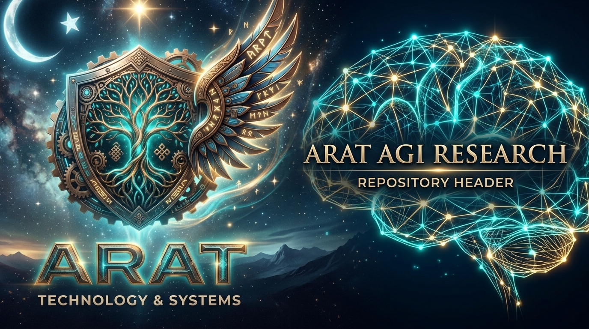

# Arat AGI Research (arat-agi-research)



[](#)
[](#)
[](#)
[](#)
[](#)
[](#)

> *"Yaratamadığım şeyi anlayamam."* - **Richard Feynman**
>
> *"Zeka, evrenin kendisini anlamlandırma biçimidir. Bizim görevimiz bu süreci hızlandırmaktır."* - **David Deutsch** (The Beginning of Infinity)
>
> *"Gözlemlediğimiz şey doğanın kendisi değil, doğanın bizim soru sorma yöntemimize maruz kalmış halidir."* - **Werner Heisenberg** (Physics and Philosophy)

**Arat AGI Research**, Arat ekosisteminin Yapay Genel Zeka (AGI), otonom bilişsel mimariler, uç sistemler (Edge AI), nöromorfik hesaplama ve bedenlenmiş robotik sistemler (Embodied AI) üzerine yürüttüğü resmi, çok disiplinli araştırma manifestosudur.

---

## Ⅰ. Bölüm I: Vizyon ve Teknoloji Felsefesi

> *"Makineler düşünebilir mi? Bu soruyu cevaplamak için, 'makine' ve 'düşünmek' kelimelerinin anlamlarını dikkatlice tanımlamamız gerekir."* - **Alan Turing** (Computing Machinery and Intelligence)

Arat olarak, mevcut yapay zeka paradigmasının temel bir sınırlaması olduğuna inanıyoruz: Zeka, devasa veri merkezlerinde hapsolmuş istatistiksel bir olasılık dağılımından ibaret olamaz. Gerçek zeka; çevresiyle etkileşime giren, kaos anında hayatta kalabilen ve kısıtlı donanım kaynaklarıyla optimal kararları alabilen **otonom bir yapı** olmalıdır. 

AGI araştırmalarımız, teknoloji felsefesi ile sistem mimarisi prensiplerinin kesişim noktasında durur. Hedefimiz, trilyonlarca parametreli hantal modeller yaratmak değil, sistem orkestrasyonunu maksimize ederek modüler, çevik ve "kendi varlığının farkında olan" otonom sistemler (Synthetic Nous) inşa etmektir. 

---

## Ⅱ. Bölüm II: Teorik ve Matematiksel Çerçeve

Geliştirdiğimiz bilişsel mimariler serbest enerji prensibi, kuantum olasılık teorisi, kurucu kuramı, biyolojik nöromorfik dinamikler ve self-supervised dünya modellerinin kesişiminde yer alır.

### 1. Varyasyonel ve Beklenen Serbest Enerji (Free Energy Principle - Karl Friston)
Ajanın çevresel belirsizliği minimize etme döngüsü:

$$ F = D_{KL}(q(\mathbf{z}) \parallel p(\mathbf{z})) - \mathbb{E}_{q(\mathbf{z})}[\log p(\mathbf{x} \mid \mathbf{z})] $$

$$ G(\pi) \approx \underbrace{D_{KL}(q(\mathbf{x}_{\tau} \mid \pi) \parallel p(\mathbf{x}_{\tau}))}_{\text{Pragmatik Fayda}} + \underbrace{\mathbb{E}_{q(\mathbf{z}_{\tau} \mid \pi)} [H(q(\mathbf{x}_{\tau} \mid \mathbf{z}_{\tau}, \pi))]}_{\text{Epistemik Merak}} $$

### 2. Kuantum Biliş (Quantum Cognition) & Lindblad Dinamiği
Bağlamsallık ve sıra etkilerini yönetmek için açık sistem kuantum dinamiği Runge-Kutta 4 (RK4) ile çözülür:

$$ \frac{d\rho}{dt} = -i[H, \rho] + \sum_{k} \gamma_k \left( L_k \rho L_k^\dagger - \frac{1}{2} \{L_k^\dagger L_k, \rho\} \right) $$

Sistem belirsizliği von Neumann Entropisi ile izlenir ($S(\rho) = -\text{Tr}(\rho \ln \rho)$) ve Born kuralı ile eyleme çöker ($P(m) = \text{Tr}(M_m \rho M_m^\dagger)$).

### 3. Kurucu Kuramı (Constructor Theory)
Dönüşümler $T = \{S_{in} \rightarrow S_{out}\}$ olarak doğrulanır. Kurucu $C$, eylem sonrasında değişmeden kalan veya kendini onaran fiziksel yapıdır ($C \otimes S_{in} \rightarrow C \otimes S_{out}$). Termodinamik kısıtlar ($\Delta E \le W$, $\Delta S_{tot} \ge 0$) eylemden önce denetlenir.

### 4. Nöromorfik Biliş & Spiking Neural Networks (LIF + STDP)
Olay-tabanlı (event-driven) mikro-watt algılama Leaky Integrate-and-Fire diferansiyel denklemi ve Spike-Timing-Dependent Plasticity (STDP) ile yürütülür:

$$ \tau_m \frac{dV}{dt} = -(V - V_{rest}) + R \cdot I_{syn} $$

$$ \Delta w = \begin{cases} A_+ \exp\left(-\frac{\Delta t}{\tau_+}\right) & \Delta t > 0 \quad (\text{LTP}) \\ -A_- \exp\left(\frac{\Delta t}{\tau_-}\right) & \Delta t < 0 \quad (\text{LTD}) \end{cases} $$

### 5. Self-Supervised RSSM Dünya Modeli & Epistemik Merak
Deterministik $h_t$ ve stokastik $z_t$ gizli durum uzayında ortam dinamiği modellenir:

$$ h_t = f(h_{t-1}, z_{t-1}, a_{t-1}), \quad p(z_t \mid h_t) \sim \mathcal{N}(\mu_{prior}, \sigma_{prior}), \quad q(z_t \mid h_t, x_t) \sim \mathcal{N}(\mu_{post}, \sigma_{post}) $$

$$ R_{\text{intrinsic}} = \beta_{KL} D_{KL}(q(z_t \mid h_t, x_t) \parallel p(z_t \mid h_t)) + \beta_{\text{recon}} \|x_t - \hat{x}_t\|^2 $$

### 6. Non-Linear Füzyon (UKF) & Dinamik Yörünge (DWA)
Scaled Unscented Transform ile türevsiz durum takibi ($2n+1$ sigma noktası):

$$ \chi_0 = \bar{x}, \quad \chi_i = \bar{x} + \left(\sqrt{(n + \lambda) P}\right)_i, \quad \chi_{i+n} = \bar{x} - \left(\sqrt{(n + \lambda) P}\right)_i $$

Ve Dynamic Window Approach ile engel sakınma:

$$ J(v, \omega) = \alpha \cdot \text{heading}(v, \omega) + \beta \cdot \text{dist}(v, \omega) + \gamma \cdot \text{velocity}(v, \omega) $$

---

## Ⅲ. Bölüm III: Dizin Topolojisi

```bash
arat-agi-research/
├── docs/
│   ├── ARAT_MANIFESTO.md         # Kurumsal AI ahlakı ve mühendislik prensipleri
│   ├── epistemology_of_ai.md     # Zekanın epistemolojisi ve Markov Blanket
│   ├── system_architecture.md    # OMEGA/AGI v2.0 sistem mimari şemaları
│   └── quantum_cognition_and_constructor_theory.md # Kuantum biliş & kurucu teorisi
├── core_cognition/
│   ├── reasoning_engine/         # FEP tabanlı aktif çıkarım algoritmaları
│   ├── episodic_memory/          # Epizodik, çalışma ve semantik vektör konsolidasyonu
│   ├── agent_orchestration/      # Çoklu-ajan Pub/Sub & inanç füzyonu (Linear / Log-Linear)
│   ├── quantum_cognition/        # Kuantum Biliş & Lindblad RK4 dinamikleri
│   ├── constructor_theory/       # David Deutsch Kurucu Kuramı görev ağı
│   ├── neuromorphic/             # SNN, LIF, Izhikevich & STDP sinaps motoru [NEW]
│   └── world_model/              # RSSM Dünya Modeli & Epistemik Merak Motoru [NEW]
├── edge_inference/
│   ├── cpp_tensor_runtimes/      # INT8 kuantizasyon, Tiled GEMM ve çalışma zamanı
│   ├── memory_allocators/        # SIMD Arena Allocator ve filigran (rollback)
│   ├── cuda_kernels/             # SwiGLU, GELU, RMSNorm, RoPE ve FlashAttention-2 [MODIFIED]
│   ├── kv_cache/                 # Paged KV-Cache yöneticisi ve INT8 bloklama [NEW]
│   └── edge_demo.cpp             # Bağımsız C++ donanım ve çıkarım doğrulama demosu
├── autonomous_control/
│   ├── sensor_fusion/            # Kalman, 2D EKF ve Scaled Unscented Transform (UKF)
│   ├── kinematic_loops/          # Diferansiyel kinematiği ve PID hız/açı denetleyicileri
│   ├── trajectory_planning/      # Quintic jerk-minimizing yörünge & DWA yerel planlayıcı
│   └── embodied_bridge/          # ROS2/DDS köprüsü, QoS ve Sim2Real domain randomizer [NEW]
├── tests/
│   ├── test_cognition.py         # Aktif çıkarım testleri
│   ├── test_orchestration.py     # Asenkron iletişim testleri
│   ├── test_control.py           # Kinematik ve 1D Kalman testleri
│   ├── test_ekf.py               # 2D non-linear EKF testleri
│   ├── test_quantum_cognition.py # Kuantum durum, entropi ve Lindblad testleri
│   ├── test_constructor_theory.py # Kurucu teorisi testleri
│   ├── test_ukf.py               # UKF sigma noktaları testleri
│   ├── test_trajectory_planning.py # DWA engel sakınma testleri
│   ├── test_neuromorphic.py      # LIF, Poisson encoder, STDP sinaps testleri [NEW]
│   ├── test_world_model.py       # RSSM, hayal gücü rollout ve merak testleri [NEW]
│   └── test_embodied_bridge.py   # ROS2 mesaj, DDS deadman ve Sim2Real testleri [NEW]
├── main.py                       # OMEGA/AGI v2.0 Master Birleşik Simülasyon Döngüsü [UPGRADED]
├── CMakeLists.txt                # C++ / CUDA derleme betiği
└── README.md
```

---

## Ⅳ. Bölüm IV: Yol Haritası (Roadmap)

* [x] **Aşama 1: Bilişsel Temeller (Q3 2026)**
* [x] **Aşama 2: Edge Optimizasyonu ve EKF Entegrasyonu (Q4 2026)**
* [x] **Aşama 3: Kuantum Karar Alma, Kurucu Teorisi ve UKF/DWA Robotik (Tamamlandı)**
* [x] **Aşama 4: Nöromorfik SNN, RSSM Dünya Modeli, FlashAttention ve ROS2 Sim2Real (Tamamlandı)**
* [ ] **Aşama 5: Fiziksel Donanım Bedenlenmesi & Canlı Saha Konuşlandırması (2027)**

---

## Ⅴ. Bölüm V: İletişim ve Kurumsal Kimlik

**Baş Sistem Mimarı ve Geliştirici:** [@arch-yunus](https://github.com/arch-yunus) / [@bahattinyunus](https://github.com/bahattinyunus)

**Araştırma Kuruluşu:** Arat Enterprise / Startup Division

---

*© 2026 Arat. All rights reserved. Building the mind of tomorrow, today.*
