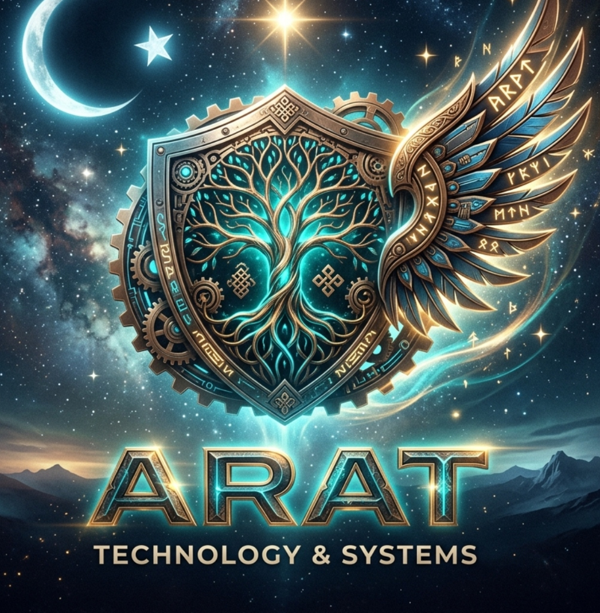
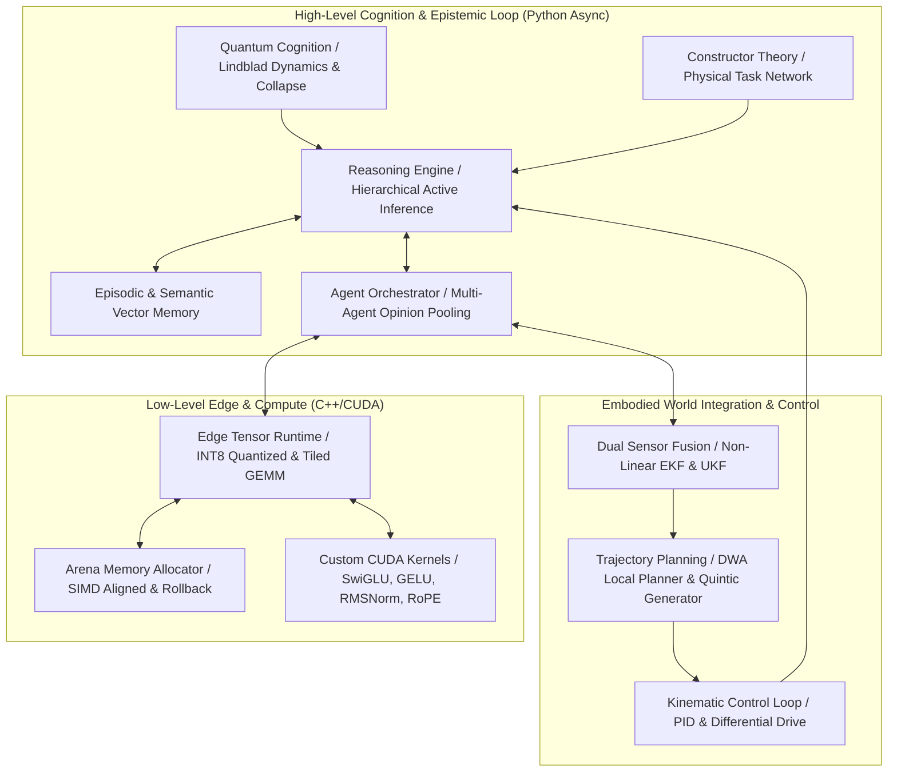

# Arat OMEGA/AGI Sistem Mimarisi



Bu belge, Arat AGI ekosisteminin çekirdek mimari yapısı olan **OMEGA/AGI** mimarisini ve bileşenler arası veri/kontrol akışlarını tanımlar.

---

## 1. Mimari Genel Bakış

OMEGA/AGI, yüksek seviyeli bilişsel süreçleri (Python) ile düşük seviyeli gerçek zamanlı uç çıkarım ve robotik kontrol döngülerini (C++/CUDA) birleştiren hibrit, asenkron ve modüler bir mimaridir.



---

## 2. Bilişsel ve Fiziksel Veri Akış Şeması (Bilişsel Döngü)

```text
 +---------------------------------------------------------------------------------------+
 |                     YÜKSEK SEVİYELİ BİLİŞSEL DÖNGÜ (PYTHON ASYNC)                     |
 |                                                                                       |
 |   [Quantum Cognition] ===> (Karar Çökmesi) ===> [Hierarchical Active Inference (FEP)] |
 |           ^                                                   ||                      |
 |   [Constructor Theory] => (Yapılabilirlik Onayı) => [Reasoning Engine]                |
 |                                                               ||                      |
 |   [Episodic Memory] <=== (Deneyim Kaydı & Geri Çağırma) <==== [Orchestrator Pool]     |
 |           ||                                                  ||                      |
 |   [Semantic Consolidation]                                    \/                      |
 +---------------------------------------------------------------||----------------------+
                                                                 || (Eylem / Hedef)
                                                                 \/
 +---------------------------------------------------------------------------------------+
 |                        FİZİKSEL VE UÇ HESAPLAMA DÖNGÜSÜ (C++ / CUDA)                  |
 |                                                                                       |
 |   [Dual Fusion: UKF & EKF] ===> (Durum Kestirimi) ===> [DWA Trajectory Planner]       |
 |             ^                                                   ||                    |
 |             || (Gürültülü Sensör Verisi)                        || (v, omega Komut)   |
 |             ||                                                  \/                    |
 |      [Sensör Girişleri] <============================= [Diferansiyel Kinematik (PID)] |
 +---------------------------------------------------------------------------------------+
```

---

## 3. Bileşen Rolleri ve İletişim Protokolleri

### A. Yüksek Seviyeli Bilişsel Katman (Python)
1.  **Quantum Cognition (Kuantum Biliş Motoru):** Karmaşık karar anlarında bilişsel hipotezleri bir Hilbert uzayında süperpozisyon halinde tutar. Çevresel gürültü altında Lindblad Master Denklemi ile açık kuantum dinamiğini çözer; duyusal gözlem anında Born kuralı ile ölçüm çökmesi sağlayarak klasik Bayesçi sınırları aşar.
2.  **Constructor Theory (Kurucu Kuramı Görev Planlayıcısı):** David Deutsch ve Chiara Marletto'nun formülasyonu uyarınca görevleri $T = \{S_{in} \rightarrow S_{out}\}$ dönüşümleri olarak doğrular. Robotun bir eylemi gerçekleştirirken kurucu olarak stabilitesini koruyup koruyamayacağını ve termodinamik kabul edilebilirliğini kontrol eder.
3.  **Hierarchical Active Inference (Hiyerarşik Aktif Çıkarım):** Üst seviye (hedef/bağlam) ve alt seviye (reaktif motor) olmak üzere iki katmanlı Varyasyonel Serbest Enerji minimizasyonu yürütür.
4.  **Episodic & Semantic Memory:** Ham deneyimleri epizodik bellekte depolar; ardından state-action kümelerini istatistiksel genellemeler halinde semantik vektör uzayına konsolide eder.
5.  **Agent Orchestration:** Çoklu-ajan yapısında doğrusal konsensüs (Linear Opinion Pool) ve log-doğrusal uzman çarpımı (Log-Linear Product of Experts) ile epistemik inançları kaynaştırır.

### B. Düşük Seviyeli Uç Çıkarım Katmanı (C++/CUDA)
1.  **Edge Tensor Runtime:** FP32, FP16 ve INT8 simetrik kuantizasyon modlarını destekler; önbellek dostu bloklu (tiled) GEMM matris çarpımı sunar.
2.  **Arena Memory Allocator:** Önceden tahsis edilmiş SIMD hizalı (16-bayt) bellek bloklarında dinamik bellek ayırma gecikmelerini sıfırlar. Filigran (watermark checkpointing) ve O(1) geri alma (rollback) yeteneğine sahiptir.
3.  **CUDA Kernels:** SwiGLU, GELU, RMSNorm ve RoPE (Rotary Position Embedding) işlemlerini GPU üzerinde hızlandırır; donanım bulunmadığında CPU fallback rutinlerini çalıştırır.

### C. Fiziksel Entegrasyon Katmanı (Autonomous Control)
1.  **Dual Sensor Fusion (EKF & UKF):** 2D diferansiyel robot takibinde türeve ihtiyaç duymayan Scaled Unscented Transform tabanlı UKF ve Jacobian tabanlı EKF ile sensör verilerini birleştirir.
2.  **Trajectory Planning (Yörünge Planlama):** Sarsıntıyı minimize eden 5. derece (quintic) polinom yörünge üreteci ve dinamik hız kısıtları altında engelleri aşan Dynamic Window Approach (DWA) yerel planlayıcısını barındırır.
3.  **Kinematic Loops:** PID hız ve yönelim kontrol döngüleri ile motor sürücülerine doğrudan PWM/hız referansı üretir.

---

*© 2026 Arat Enterprise. OMEGA/AGI Architecture Specification.*
