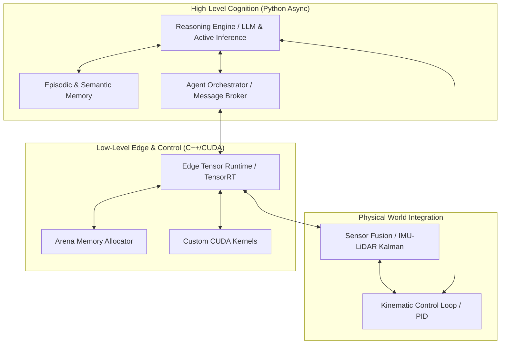

# Arat OMEGA/AGI Sistem Mimarisi

Bu belge, Arat AGI ekosisteminin çekirdek mimari yapısı olan **OMEGA/AGI** mimarisini ve bileşenler arası veri/kontrol akışlarını tanımlar.

---

## 1. Mimari Genel Bakış

OMEGA/AGI, yüksek seviyeli bilişsel süreçleri (Python) ile düşük seviyeli gerçek zamanlı uç çıkarım ve robotik kontrol döngülerini (C++/CUDA) birleştiren hibrit, asenkron ve modüler bir mimaridir.

---

## 2. Bileşen Rolleri ve İletişim Protokolleri

### A. Yüksek Seviyeli Bilişsel Katman (Python)
1.  **Reasoning Engine (Bilişsel Çıkarım Motoru):** Aktif çıkarım algoritmalarını çalıştırır. LLM girdilerini kullanarak dünya modelini günceller ve Variational Free Energy hesaplamalarını yapar.
2.  **Episodic Memory (Epizodik ve Semantik Hafıza):** Ajanın geçmiş yaşantılarını (durum-eylem dizileri) sqlite/numpy tabanlı hızlı bir vektörel veritabanında saklar.
3.  **Agent Orchestrator (Ajan Orkestrasyonu):** Çoklu-ajan yapısında asenkron `asyncio` tabanlı Pub/Sub kanalları sağlar. Ajanların epistemik durumlarını senkronize eder.

### B. Düşük Seviyeli Uç Çıkarım Katmanı (C++/CUDA)
1.  **Edge Tensor Runtime:** Model ağırlıklarını ve girdi/çıktı tensörlerini yönetir. Quantized (INT8/FP16) çıkarımları milisaniyenin altında gecikmeyle yürütür.
2.  **Arena Memory Allocator:** Gömülü işletim sistemlerinde dinamik bellek ayırma gecikmelerini (`malloc`/`new` overhead) ortadan kaldırmak için deterministik, önceden ayrılmış bellek blokları (Arena) sunar.
3.  **CUDA Kernels:** Aktivasyon fonksiyonları (SwiGLU, GELU) gibi yoğun matris işlemlerini GPU üzerinde hızlandırır.

### C. Fiziksel Entegrasyon Katmanı (Autonomous Control)
1.  **Sensor Fusion (Sensör Füzyonu):** IMU ve LiDAR sensörlerinden gelen yüksek frekanslı gürültülü verileri Kalman filtresi ile temizleyerek temiz durum tahminleri üretir.
2.  **Kinematic Loops (Kinematik Kontrol):** Bilişsel katmandan veya çıkarım motorundan gelen hız/yön komutlarını PID denetleyicileri aracılığıyla motor sürücülerine (actuators) iletir.

---

## 3. Veri ve Kontrol Akışı (Epistemic-Action Loop)

1.  **Algı (Perception):** `Sensor Fusion` modülü fiziksel dünyadan verileri toplar ve durumu tahmin eder.
2.  **Bellek Geri Çağırma (Memory Retrieval):** Durum tahmini `Episodic Memory`'e gönderilir ve benzer geçmiş deneyimler çekilir.
3.  **Karar Alma (Reasoning):** `Reasoning Engine` mevcut durum ve bellek verilerini alarak serbest enerjiyi minimize edecek optimal eylemi planlar.
4.  **Eylem (Action):** Seçilen eylem `Kinematic Loops` üzerinden fiziksel dünyaya aktarılır.
5.  **Öğrenme (Learning):** Eylemin sonucu (yeni gözlem) kaydedilerek bellek güncellenir.
